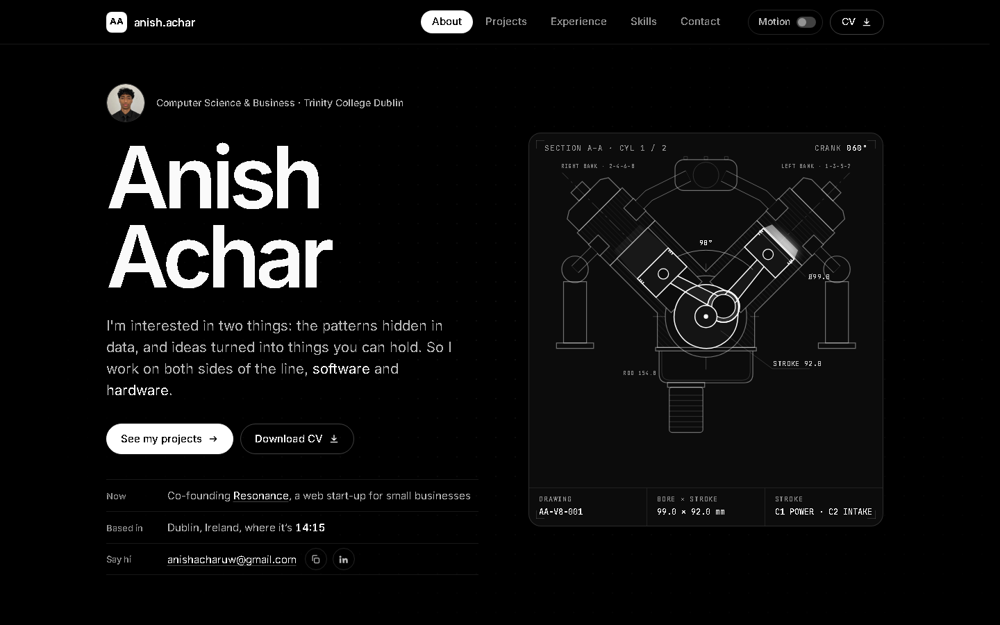

<div align="center">

# anishachar.com

**My personal site and portfolio: a minimal black-and-white, tabbed CV where each project opens into its own interactive space.**

[**Visit anishachar.com**](https://anishachar.com)




</div>

---

## What's on it

Five tabs (About, Projects, Experience, Skills, Contact), each with its own URL hash. The Projects tab has seven tiles that **maximise** into a full panel and **minimise** back to the grid:

| # | Project | What you can do on the page |
|---|---|---|
| 01 | **V8 Engine** | Spin and take apart the 40-part SOLIDWORKS assembly in 3D ([repo](https://github.com/Anish-Achar/v8-engine)) |
| 02 | **NO Candle Strategy** | Step through the trading rules and explore 11,142 backtests by pair ([repo](https://github.com/Anish-Achar/no-candle-strategy)) |
| 03 | **Study content** | My most-viewed TikTok study videos and the SimpleStudy ambassador programme |
| 04 | **Bikes & mechanics** | An interactive bike drawing and parts explorer |
| 05 | **Ghost Ball** | Use the real pool app in a phone frame, and drag the balls to play with its maths ([repo](https://github.com/Anish-Achar/ghost-ball)) |
| 06 | **Rocket fin can** | A 3D viewer with a live flutter lab: change fin thickness and watch the safety margin |
| 07 | **Zeto** | The internship tracker my team built at a hackathon, with its launch video |

## How it's built

- **Plain HTML, CSS and JavaScript modules.** No framework and no build step: the folder is the site.
- **3D:** three.js renders the V8 and the fin can from geometry exported straight out of SOLIDWORKS (`assets/data/*.bin`).
- **Charts** are hand-drawn SVG, with no charting library.
- **Motion:** View Transitions between tabs, WAAPI clip-path animations when a project opens, Lenis smooth scrolling, a custom cursor and magnetic buttons. A switch in the nav turns motion down, and the device's reduced-motion setting is respected.
- **Private by default:** fonts, three.js and Lenis are self-hosted, so the site makes **zero third-party requests**, sets no cookies and has no analytics. See [`legal.html`](legal.html).
- **Accessible:** keyboard-operable 3D viewers, transcripts for the videos, and contrast-checked colours.

## Structure

```
├── index.html            # all page content: tabs, project panels, CV text
├── ghost-ball/           # the Ghost Ball app (embedded on the site)
├── legal.html            # privacy, terms, accessibility, credits & licences
├── 404.html
├── assets/
│   ├── css/              # site.css (design system) + one file per heavy project
│   ├── js/               # main.js (tabs, panels), fx.js (motion), v8.js, trading.js, fincan.js, …
│   ├── data/             # V8 and fin can geometry, trading results, chart data
│   ├── img/  media/      # renders, screenshots and project videos
│   ├── fonts/            # self-hosted Inter + JetBrains Mono
│   ├── vendor/           # three.js and Lenis, with their licences
│   └── docs/             # the fin can design report (PDF)
├── robots.txt  sitemap.xml  site.webmanifest
```

## Run it locally

The 3D models and chart data are loaded with `fetch`, so serve the folder rather than double-clicking `index.html`:

```bash
git clone https://github.com/Anish-Achar/anishachar.com.git
cd anishachar.com
python -m http.server 8000
```

Then open http://localhost:8000. Any other static server (for example VS Code's Live Server) works too.

## Deploying

The site is static, so any static host works. It's served from the domain root, because `404.html` uses root-relative links.

---

<sub>© Anish Achar. All rights reserved. More projects on my <a href="https://github.com/Anish-Achar">GitHub profile</a>.</sub>
